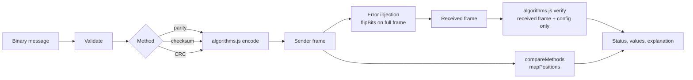

# Data Transmission Error Detection Simulator

## Abstract
A browser-based simulator for three classic error-detection methods used in data communication: **parity**, the **1's-complement checksum**, and the **Cyclic Redundancy Check (CRC)**. You enter a binary message, build a transmitted frame, corrupt chosen bits of that frame, and watch the receiver verify it using only what it received. A comparison view runs all three methods on the same message and a mapped error pattern. Undetected errors are shown honestly as legitimate results.

A lightweight HTML, CSS and vanilla JavaScript simulator that runs locally in your browser without a server or build tools.

## Features
- Binary message input with validation, presets and bit counter (max 256 bits in the UI).
- Even/odd parity, 8-bit 1's-complement checksum, CRC with an editable, validated generator (default `1101`).
- Sender frame, error injection and received frame displayed with distinct styling for payload, padding, detection bits, selected bits and changed bits.
- Error injection: click bits, type positions (`3, 9, 12`), or random pick with count and **seed** (reproducible); no-error transmission.
- Receiver panel with method-specific values (ones count / checksum sums / CRC remainder), a clear status, and a plain-language explanation. Undetected corruption triggers an explicit warning.
- Step-by-step views of the 1's-complement additions and the modulo-2 divisions.
- Comparison of all three methods, with explicit position mapping, plus a 10-entry experiment history.
- Keyboard-friendly, labelled controls, visible focus, responsive layout.

## Requirements and running
- A modern browser. Open **`index.html`** directly (double-click). Nothing else.
- Node.js 18+ only if you want to run the automated tests.

## Quick start
1. Download or clone the repository.
2. Open `index.html` in a modern browser to use the simulator; no dependency installation is required.
3. To run the automated test suite, install Node.js 18 or newer and run `npm test` from the project folder.

## Conventions
**Bit positions** are **one-based and counted from the left**: position 1 is the first bit transmitted, position N the last bit of the frame. The UI and docs use this everywhere. Errors are applied to the *complete transmitted frame*, including detection bits.

### Frame formats
| Method | Frame | Detection bits |
|---|---|---|
| Parity | `payload \| parity bit` | 1 (appended on the right). Even: total 1s even; odd: total 1s odd |
| Checksum | `payload \| 8-bit checksum` | 8 |
| CRC | `payload \| remainder` | `generator.length - 1` |

### 8-bit checksum convention
1. Split the payload into 8-bit words from the left.
2. If the last word is short, **pad with 0 bits on the right**. Padding is a calculation convention only: it is **not transmitted**. The receiver knows the payload length (frame length − 8) and applies the same padding. Input is never truncated.
3. Add words with **end-around carry** (any carry out of bit 8 is added back, repeated while a carry remains).
4. Checksum = bitwise complement of the sum.
5. Receiver: split off the last 8 bits, pad the payload, add all words **including** the checksum. Valid if the result is `11111111`.

Example: `10110101 + 11001100 = 1 10000001` → wrap carry → `10000010`; checksum `01111101`. Receiver: `10000010 + 01111101 = 11111111`.

### CRC
- Generator must be binary, ≥ 2 bits, start with `1` and end with `1` (max 33 bits). `1101` = x³ + x² + 1.
- Sender: append `r = len(generator) − 1` zeros, divide by modulo-2 (XOR) division, append the `r`-bit remainder.
- Receiver: divide the whole received frame by the same generator. Remainder `0…0` ⇒ **"No error detected"** (not proof of error-free delivery); non-zero ⇒ "Error detected".
- Verified example: message `11010011101100`, generator `1011` → remainder `100`, codeword `11010011101100100`. Also cross-checked against CRC-8 (poly 0x07) of ASCII `"123456789"` = `0xF4` and an independent BigInt implementation.

### Parity
Detects any **odd** number of flipped bits in the protected frame; misses any **even** number. Example: `1011` even parity → `10111`; flipping bits 1 and 2 gives `01111` which still has an even number of 1s: undetected.

## Comparison mapping
Frames differ in length, so positions are not compared blindly. Errors are chosen on the *currently selected* method's frame. For the other methods: a payload position `p` maps to the same `p` (payload always comes first); a flipped detection bit maps to the detection bit with the same offset (k-th check bit). If the other frame has fewer detection bits it maps to the last one, and positions that collapse together are dropped and reported in the UI.

## How to demonstrate
1. Keep the 16-bit preset, method **Parity**, press **Generate frame**.
2. Type `1` in the position box → **Select** → **Transmit with errors**: *Error detected*.
3. Select `1, 2` → transmit: *No error detected* + corruption warning (parity miss).
4. Press **Compare all three methods**: checksum and CRC catch this pattern.
5. Choose the **Column-swap** preset, method Checksum, errors `8, 16`: checksum misses; compare shows CRC detects.
6. Use **Reset all** to start over, or switch method to re-encode the same message.

## Tests
```
npm test            # or: node --test
```
24 tests (`algorithms.test.js`) using Node's built-in runner; see [TEST_CASES.md](TEST_CASES.md).

## Architecture

- `algorithms.js` – pure functions, no DOM; works in browser and Node.
- `app.js` – state, validation, rendering. `index.html`, `styles.css` – layout and theme.
- `algorithms.test.js`, `package.json` – tests only.

## Error detection vs error correction
*Detection* only tells the receiver that something is wrong (then it typically asks for retransmission). *Correction* (e.g. Hamming codes, Reed–Solomon) adds enough redundancy to locate and repair errors. This project implements detection only.

## Limitations
- Simulates random bit flips only: no bit loss/insertion, no framing, no retransmission.
- Checksum receiver assumes the frame length tells the payload length (padding not transmitted).
- Checksum is an educational 8-bit variant, not the 16-bit Internet checksum. CRC generator is limited to 33 bits and the simulator does not use reflected/initial-value CRC variants.
- Random-error undetected rates are not estimated.
- UI was smoke-checked in headless Chrome only; no full cross-browser test.

## Applications
Ethernet (CRC-32), TCP/UDP/IP headers (Internet checksum), storage and serial links (CRC), simple serial protocols (parity).

## Future scope
Hamming-code correction, 16-bit Internet checksum option, CRC presets (CRC-8/16/32), burst-error injection, Monte-Carlo detection statistics, transmission animation.
